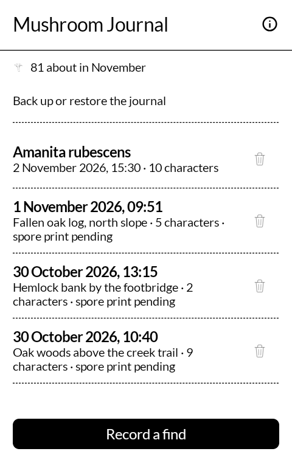
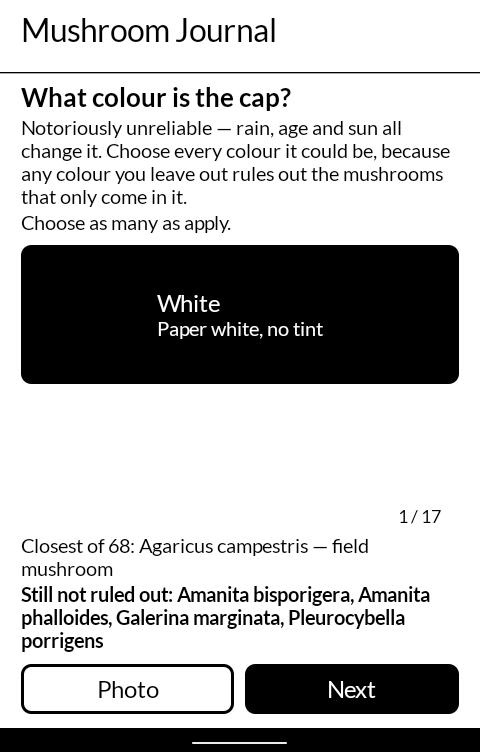
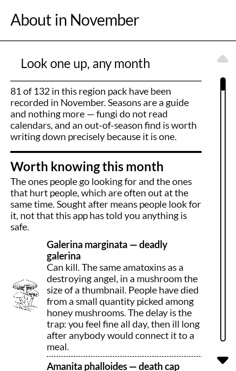
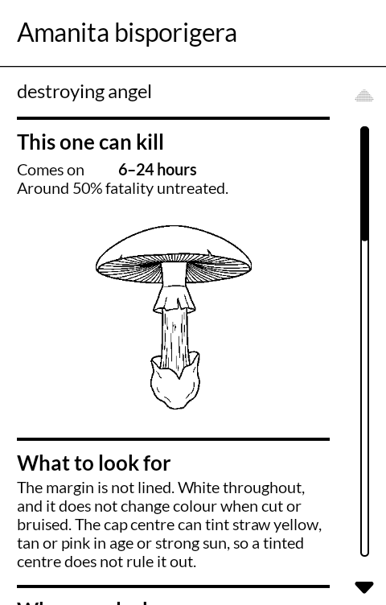

# 茸帳 kinokochō — Mushroom Journal

A mushroom field journal for the [Mudita Kompakt](https://mudita.com/products/kompakt/),
built for its E Ink screen.

Not a fork. Written from scratch in Kotlin and Jetpack Compose, using Mudita's own
[MMD](https://github.com/mudita/MMD) design system so it looks like the apps the phone
already ships with.

*Kinokochō* is 茸帳 — a mushroom notebook. The 帳 is the one in 手帳 (pocket notebook)
and 野帳 (a surveyor's field book): a plain book you fill by going places.

| | |
|---|---|
|  |  |
|  |  |

## What it is, and what it is not

**It does not tell you what a mushroom is, and it will never tell you whether one is
edible.** There is no edibility field anywhere in it, by design. A phone that answers that
question confidently is a phone that eventually kills someone.

What it does is let you *write a mushroom down properly* while you are standing over it,
and then help you work out what you are looking at once you get home.

- **In the field:** record the characters you can actually see — substrate, hymenophore,
  gills, cap, stipe, flesh — in any order and however few of them. Add a note. Take
  photographs into labeled slots. The candidate list narrows as you go, and is always
  presented as *not yet ruled out*, never as an answer.
- **At home:** review the entry on a real screen with the photographs in color, add the
  spore print you set overnight, and see which unrecorded character would have narrowed
  things most — the part that trains the next walk.
- **Then ask someone:** send the find out as plain text and photographs through whatever
  the phone already has — a message, an email, a forum post. It goes as a description and
  a shortlist of what has *not* been ruled out, with what you looked at and could not say
  said plainly, because that is the first thing anybody experienced will ask.
- **And keep a copy:** the whole journal, photographs and all, written to a zip and handed
  wherever you want it, and read back in on the other side of a lost phone. The database
  holds notes that cannot be taken again — the mushroom is gone and the season is over —
  and a book that lives in exactly one place is a book with a date on it. Reading a copy
  back in only ever adds: an old backup onto a journal that has been used since keeps
  both.
- **And write down the answer:** when somebody tells you what it was, there is a line to
  put it on. That is the whole point of keeping the book.

## Why E Ink is the right screen for this

Color is diagnostic in mushroom identification and E Ink cannot show it. That would be
fatal for an identification app — but this is a *recording* app. Color matters when you
decide, and deciding happens at home, on a screen that has it. In the field what you want
is a notebook that lasts days on a charge, reads in direct sun, and does not have anything
else on it.

## Structure

The character schema is global; the taxon data is a swappable region pack. Southern
Appalachia is pack one, for now: other regions are very welcome, and I would be glad to
work with others to bring the guide to them. Write to email@wanderthe.dev or open an
issue.

Everything generated is generated: the drawings from `tools/make-art.py`, the pack from
the `tools/add-*.py` batches, the illustrator's brief from the pack itself. A file that
has to be kept in step by hand is a file that drifts, and a work order that has drifted
from the data is worse than none.

Two checks live outside the test suite because they need the network and depend on other
people's databases moving under them. Run both when the pack changes.

`tools/verify-names.py` records, for every name in the pack, which outside authority says
the mushroom exists — and `PackIntegrityTest` refuses any taxon missing from that record.
This is the one guard that matters most here. A fabricated species has a perfect shape:
correct Latin, real genus, real epithet, and every other test in the suite green. The only
thing that catches it is somebody outside this repository having heard of it. The network
stays in the tool, where a flaky lookup delays a change; the rule stays in the test, where
it always runs.

`tools/check-names.py` asks GBIF and iNaturalist whether every name exists. The tests can
see that a name is a well-formed binomial, that its id agrees with it, that its lookalikes
resolve — and all of that passes for a name that is well-formed, consistent, and not real.

`tools/check-seasons.py` asks how each taxon's research-grade records fall across the
year here, and reports months the pack leaves out. It only ever widens: a season a month
too narrow hides a mushroom that is out and takes any warning attached to it away, while
one a month too wide shows a mushroom in a month it may not be out — which the month page
already says of every row on it. `--write` applies the widenings.

## Also in it

- **A month view.** What is about now, split evenly between the ones people go looking for
  and the ones that hurt people — which are often out at the same time. Anything lethal is
  listed however rarely it turns up. "Sought after" means people look for it; it is not
  the app saying anything is safe.
- **A page per mushroom.** What it looks like, where and when, what it is confused with and
  how to tell them apart, and how what you recorded lines up against it. Reachable from a
  shortlist, from the month view, or by looking a name up in any month. Its text can be
  selected, and a word in it sent to a dictionary app such as Define (the menu's ⋮ holds what
  the Kompakt's selection bar has no room for).
- **Measurements, age and condition.** Facts about the specimen rather than the species,
  so they are recorded rather than asked. Age earns its place: a ring or a veil that is
  missing from an old mushroom proves nothing, and the key stops ruling things out on it.
- **Offline, entirely.** The app has no internet permission. A find leaves the phone only
  when you send it to someone from the share sheet, or in a backup you save.
- **One permission**, approximate location, asked for only when you press **Add roughly where I
  am** on a find: the phone's rough position, recent or asked for then, to two decimal places,
  goes into the place.
  The place a camera wrote into a photograph is taken out as the photograph comes in, and again
  before a share or a backup.

## Status

Working and in daily use, and not finished. A hundred and thirty-two taxa in the Southern
Appalachia pack across forty-two characters, two hundred and sixteen pairs that get
confused for one another, a hundred and seventy-eight drawings of single characters and
a hundred and twelve of whole mushrooms, most of them traced from public-domain plates of the
eighteenth to early twentieth centuries, and a key that reaches the right taxon in about
four questions when the answers are true.

Every question the key can ask has an answer for every mushroom it applies to, so a
mushroom listed as fitting has not been contradicted by anything that was tapped. Where
no published description records a character at all — the taste of most Amanitas, the
KOH reaction of most boletes — the pack says so, and a mushroom that could not be
checked on an answer is listed after those that were, with a line saying what is missing.

Nothing in the pack has been checked by a mycologist. Every row says so on its own page.
Handing the find to a person who knows fungi is the answer to that, which is the whole
shape of this app — narrow it in the field, let a person decide in color, later.

The launcher mark is a drawing of a chanterelle by the author, traced rather than
imitated. The rest of the drawings are worked to the same hand — thin, few lines, no
solid black — which is written down at the top of `tools/make-art.py`.

The whole-mushroom plates are a different thing. Most are traced from public-domain
plates — C. H. Peck's New York State reports, Sowerby, Bresadola, Bulliard, Cooke, Walty
and others — by `tools/trace-plate.py`, and each one's work, year, license and file is
in `tools/plate-sources.json`; the candidate page names whose drawing it is. The other
twenty were made for this app rather than traced from an older work, so they have no entry
there and no outside source to credit. The source images are not in the repository. A plate that shows a feature its mushroom lacks is
worse than none, so where no honest drawing exists there is no plate.

## Building

```sh
./gradlew testDebugUnitTest
./gradlew assembleRelease
```

The release build is minified. It is worth actually running rather than only building:
R8 takes it from 32 MB to under 3, and a minified Android app is where the surprises
live. This one has no keep rules and needs none — see `app/proguard-rules.pro` for why.

Builds are signed with a keystore in `signing/`, which is gitignored. There is no
fallback: without it the build produces an *unsigned* APK, which will not install
anywhere. That is deliberate — a signing key committed to a public repo is not a signing
key, it is a formality, and a missing one should stop you rather than quietly hand you
something installable.

**The debug build takes the same key**, which this file used to deny. It matters: the
first install of any variant fixes the signer for good, so a debug build put on a phone is
not a throwaway — install one signed with the Android debug key and the real one will not
go over the top of it.

Questions, ideas, or just saying hello: the wander the dev Discord, <https://discord.gg/UMW8yJg7dQ>

## License

GPL-3.0-only. See [LICENSE](LICENSE). In the app, About > Licenses shows the source address,
the full license text and everything the app is built with; About also carries Privacy, Terms
and a safety note, and the same safety note is on the first-run notice.

Copyright (C) 2026 wander wildwood.
